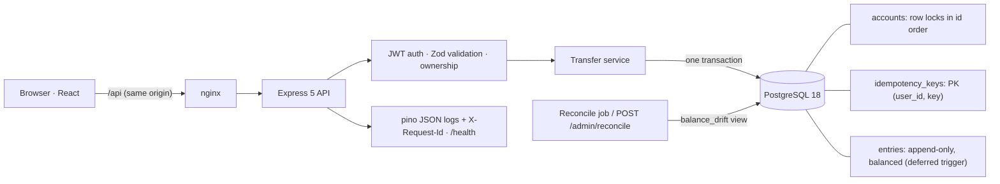

# Ledgerline

An idempotent, double-entry wallet ledger: accounts, balanced transfers, immutable entries and
keyset-paginated statements, on PostgreSQL. The interesting behaviour is what must never happen:
money created or destroyed, a retried request charged twice, or two concurrent transfers
corrupting a balance. Each of those is prevented by the database and proven by a test.

**Stack:** Node 24, Express 5, Zod, `pg`, PostgreSQL 18, pino · React 19, TypeScript, Vite, TanStack
Query, Tailwind · Vitest + Testcontainers · Docker Compose · GitHub Actions.

## Quick start

```bash
docker compose up --build
```

| | |
|---|---|
| Web app | http://localhost:8080 |
| API docs (Swagger UI) | http://localhost:3000/docs · spec: [`openapi.yaml`](openapi.yaml) |
| Health | http://localhost:3000/health |

The API container runs the migrations and seeds demo data on start. Both are idempotent: the seed
uses fixed `Idempotency-Key`s, so restarting replays the transfers instead of duplicating them.

| Demo user | Password | Role |
|---|---|---|
| `demo@ledgerline.dev` | `demo-pass-123` | customer (EGP main, EGP savings, USD wallets) |
| `omar@ledgerline.dev` | `demo-pass-123` | customer (EGP wallet) |
| `auditor@ledgerline.dev` | `audit-pass-123` | auditor (reads all accounts, runs reconciliation) |

## Architecture



One request, one transaction, one stored response. Balances are **cached** on the account row for
fast reads and overdraft checks. A reconciliation job proves they equal the sum of the entries.

## How a transfer works

```mermaid
sequenceDiagram
  autonumber
  participant C as Client
  participant A as API
  participant P as PostgreSQL
  C->>A: POST /api/v1/transfers + Idempotency-Key
  A->>A: authenticate (JWT), validate body (Zod: integer minor units)
  A->>P: BEGIN
  A->>P: INSERT idempotency_keys ... ON CONFLICT DO NOTHING
  alt key already exists
    P-->>A: stored row
    A-->>C: replay stored 201 (Idempotent-Replayed: true) or 422 if the body differs
  else key claimed
    A->>P: SELECT both accounts ORDER BY id FOR UPDATE
    A->>A: owner? same currency? enough funds?
    A->>P: INSERT transfer + debit entry + credit entry
    A->>P: UPDATE both balance_cached
    A->>P: UPDATE idempotency_keys SET response; INSERT audit_log
    A->>P: COMMIT (deferred trigger checks the entries net to zero)
    A-->>C: 201 transfer
  end
  Note over A,P: Any error rolls back everything, including the key claim,<br/>so a failed request can be retried with the same key.
```

## Invariants

| Rule | Mechanism | Proved by |
|---|---|---|
| Every transfer nets to zero per currency, with at least 2 entries | `entries_balanced` **deferred constraint trigger**, runs at COMMIT | `invariants.test.js`: unbalanced and one-sided transfers rejected |
| Entries are immutable | `BEFORE UPDATE/DELETE/TRUNCATE` trigger raising `23000` | `invariants.test.js`: raw `UPDATE`, `DELETE`, `TRUNCATE` fail |
| A wallet never goes negative | `CHECK (kind = 'system' OR balance_cached >= 0)`, plus app check under the row lock | `invariants.test.js`; `concurrency.test.js`: 100 concurrent transfers, exactly 50 succeed, balance ends at 0 |
| A key moves money at most once | `PRIMARY KEY (user_id, key)` claimed in the same transaction as the transfer | `idempotency.test.js`: same key ×20 in parallel → 1 transfer, 19 replays |
| A reused key with different parameters is rejected | Stored SHA-256 request hash compared on conflict | `idempotency.test.js`: 422 `IDEMPOTENCY_KEY_REUSED` |
| Cached balance = sum of entries | Updated in the same transaction; `balance_drift` view; reconcile job | `reconcile.test.js` (tampering detected); every concurrency test; CI `reconcile` step |
| Money is neither created nor destroyed | Balanced entries | `concurrency.test.js`: global entry sum = 0 |
| Opposite transfers can't deadlock | Lock both rows `ORDER BY id FOR UPDATE` | `concurrency.test.js`: 60 mixed A↔B all 201; the reproduced deadlock gets `40P01` without ordering |
| Amounts are positive integers | `amount_minor bigint CHECK (> 0)`; Zod `int().positive()` | `invariants.test.js`, `schemas.test.js` (floats and strings rejected) |
| Only the owner sends or views an account | Ownership checks in SQL (404, not 403) | `transfers.test.js`, `accounts.test.js` |
| Customers can't open system accounts | Zod `kind: literal("wallet")` | `accounts.test.js` |
| The audit log is append-only | Trigger (migration 002) | `invariants.test.js` |
| Currency codes are ISO-4217-shaped | `CHECK (currency ~ '^[A-Z]{3}$')` | `invariants.test.js` |

## Keyset pagination benchmark

1M-row `entries`, `EXPLAIN (ANALYZE, BUFFERS)`, page size 50. Details in
[`docs/keyset-pagination.md`](docs/keyset-pagination.md).

| Query | Time | Buffers |
|---|---|---|
| `OFFSET 100000 LIMIT 50` | 130.88 ms | 13,875 + disk spill |
| Keyset `id < cursor` (same page) | **0.12 ms** | 207 |
| Quiet account, first page, **without** `(account_id, id)` index | 36.08 ms | 8,508 |
| Quiet account, first page, **with** the index | **0.08 ms** | 165 |

## Row locks vs SERIALIZABLE

Both are implemented (`TRANSFER_MODE=locks|serializable`) and measured with
`scripts/bench-isolation.js`. Row locks are the default: they turn contention into waiting, while
SERIALIZABLE turns it into aborts and retries. See [`docs/design-notes.md`](docs/design-notes.md).

| 400 concurrent transfers | Committed | Transfers/s | Retries | Gave up |
|---|---|---|---|---|
| locks, 200 accounts | 398 / 398 | 1,833 | 0 | 0 |
| serializable, 200 accounts | 398 / 398 | 1,362 | 276 | 0 |
| locks, 4 hot accounts | 300 / 300 | 496 | 0 | 0 |
| serializable, 4 hot accounts | 127 / 300 | 320 | 902 | 173 |

## API

Base path `/api/v1`. Money is integer minor units, and bigints are returned as strings. Errors
are always `{ status, code, message }`.

| Method | Path | Auth | Notes |
|---|---|---|---|
| POST | `/auth/register` | none | Creates a customer; returns `{ token, data.user }` |
| POST | `/auth/login` | none | 401 `INVALID_CREDENTIALS` |
| GET | `/auth/me` | Bearer | Current user and role |
| GET | `/accounts` | Bearer | Own accounts (all accounts for auditors) |
| POST | `/accounts` | Bearer | `{ currency }`, opens a wallet |
| GET | `/accounts/:id` | Bearer | 404 unless owner or auditor |
| GET | `/accounts/:id/statement?cursor=&limit=` | Bearer | Keyset, newest first; `next_cursor` |
| POST | `/transfers` | Bearer + `Idempotency-Key` | 201; replay sets `Idempotent-Replayed: true` |
| POST | `/admin/reconcile` | Bearer (auditor) | `{ account_id? }` → drift report, audited |

Full contract: [`openapi.yaml`](openapi.yaml), rendered at `/docs`.

## Local development (without Docker for the app)

```bash
cp .env.example config.env        # then set DB_* and JWT_SECRET
npm install
npm run db:migrate && npm run db:seed
npm run dev                        # API on http://127.0.0.1:3000 (pretty logs)

cd frontend && npm install && npm run dev   # http://localhost:5173, proxies /api to :3000
```

## Tests

```bash
npm test              # 56 backend tests on a real PostgreSQL 18 (Testcontainers; needs Docker)
cd frontend && npm test   # money and ledger maths
```

| Suite | What it proves |
|---|---|
| `tests/unit` | Amount and currency validation, request fingerprinting |
| `auth` | Hashing, tokens (missing, invalid, expired), no user enumeration |
| `accounts` | Ownership 404s, auditor access, keyset paging with no gaps or duplicates |
| `transfers` | Balances, overdraft, currency mismatch, missing key, float rejection |
| `idempotency` | 20 parallel replays → one transfer; key reuse → 422; failures don't consume keys |
| `concurrency` | 100 concurrent debits; opposite transfers; reproduced deadlock; SERIALIZABLE mode |
| `invariants` | Raw-SQL attacks on every database rule |
| `reconcile` | Drift detection and auditor-only access |
| `migrations` | Empty database → all migrations, then idempotent re-run |

## Scripts

| Command | Purpose |
|---|---|
| `npm run db:migrate` | Apply `migration/*.sql` in order, once each (advisory-locked) |
| `npm run db:seed` | Demo users, system accounts and funded wallets (re-runnable) |
| `npm run reconcile` | Reconciliation job; exits 1 on any drift |
| `npm run chaos` | Double-spend chaos test against a running API (`API_URL=…`) |
| `npm run bench:keyset` | 1M-row OFFSET vs keyset benchmark (`BENCH_DATABASE_URL`, disposable DB) |
| `node scripts/bench-isolation.js` | Row locks vs SERIALIZABLE (disposable DB) |

## Project layout

```
app.js, server.js, config.js, db.js, log.js   Express app, startup, env, pool + withTransaction, pino
controllers/   HTTP handlers (auth, accounts, ownership, transfers, admin, errors)
services/      transferService (the one-transaction transfer), reconcileService, auditService
routes/ schemas/ middleware/   Routing, Zod schemas, Idempotency-Key header check
migration/     001 schema + invariants, 002 append-only audit log, 003 SSI-friendly balance trigger
scripts/       migrate, seed, reconcile, chaos, benchmarks
tests/         unit + integration (Testcontainers)
frontend/      React app (see frontend/README.md)
docs/          design notes, keyset benchmark, recording guide
```

## Configuration

See [`.env.example`](.env.example). Key settings: `DATABASE_URL` (or `DB_*`), `JWT_SECRET`
(required), `JWT_EXPIRES_IN` (default `1h`), `TRANSFER_MODE` (`locks` | `serializable`),
`LOG_LEVEL`. Secrets live in `config.env` / `.env`, both git-ignored.

## Security notes

- Passwords: bcrypt cost 12, capped at 72 bytes. Login takes the same time whether or not the
  email exists.
- Short-lived JWT access tokens (1h). Users are re-read on every request, so role changes apply
  immediately.
- Zod validation on every input; parameterised SQL only; `helmet`; 16 KB JSON body limit.
- Account ids can't be probed: other users' accounts return 404.
- Logs redact `Authorization` and cookies. Every request carries an `X-Request-Id`.

## Further reading

- [`docs/design-notes.md`](docs/design-notes.md): bugs hit and how they were fixed; idempotency,
  isolation and partitioning decisions
- [`docs/keyset-pagination.md`](docs/keyset-pagination.md): benchmark and index design
- [`docs/recording-workflow.md`](docs/recording-workflow.md): how to record a demo of this project
